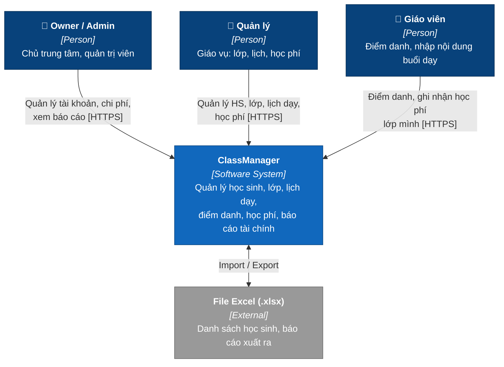
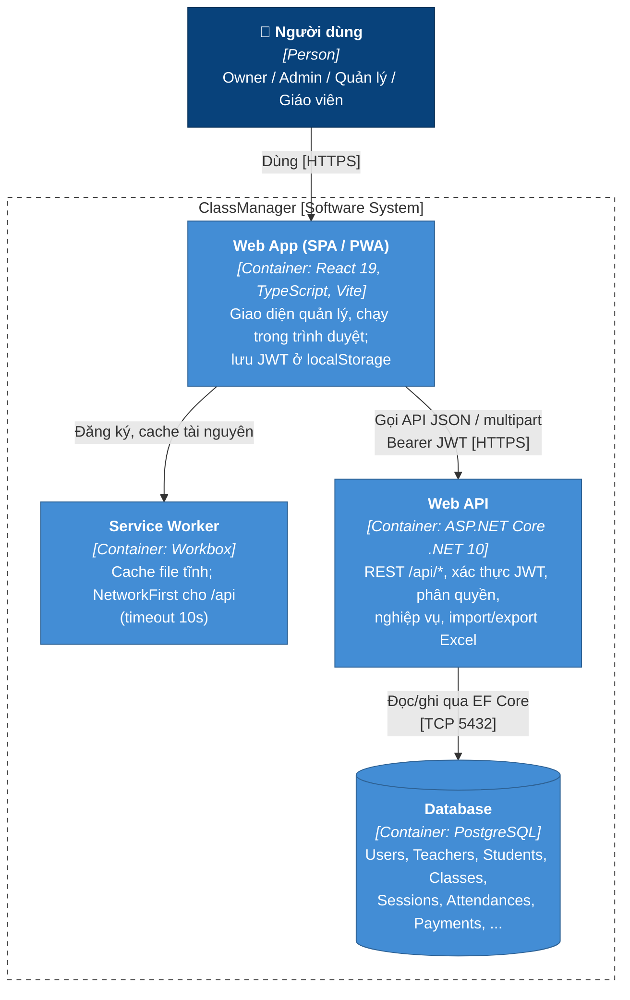
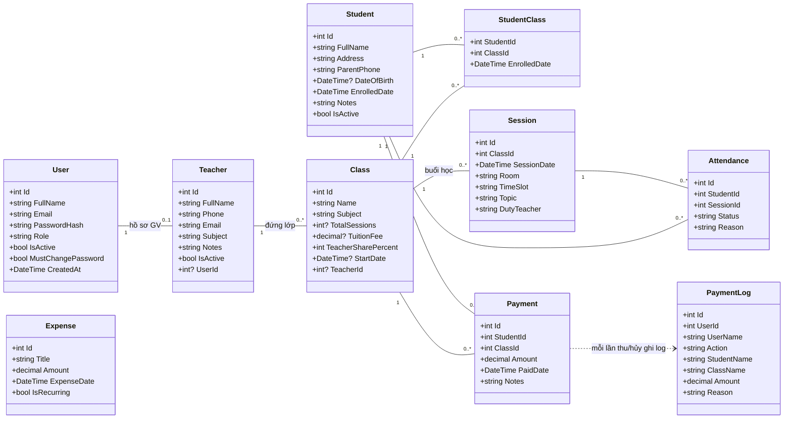

# ClassManager — Quản lý trung tâm dạy học

Ứng dụng web (cài được lên điện thoại dạng PWA) để một trung tâm dạy thêm quản lý **học sinh, giáo viên, lớp học, lịch dạy, điểm danh, học phí, chi phí và báo cáo tài chính**.

| Tài liệu | Dành cho |
|---|---|
| [README.md](README.md) (file này) | Dev: tổng quan kiến trúc (C4), cách chạy local |
| [PROJECT.md](PROJECT.md) | Dev/AI: chi tiết nghiệp vụ, API, schema, quy ước |
| [docs/HUONG_DAN_SU_DUNG.md](docs/HUONG_DAN_SU_DUNG.md) | Người dùng cuối: admin, quản lý, giáo viên |
| `docs/DEPLOY.md` | Hướng dẫn deploy — *sẽ bổ sung* |

---

## Tính năng chính

- **Học sinh**: thêm/sửa/xoá mềm, tìm kiếm, import/export Excel (tự nhận diện cột, chống trùng 3 tầng).
- **Giáo viên & tài khoản**: 4 vai trò `owner > admin > manager > teacher`; tài khoản giáo viên gắn với hồ sơ giáo viên.
- **Lớp học**: nhóm theo khối, gán giáo viên, học phí, số buổi, % chia cho giáo viên; xếp học sinh vào lớp.
- **Lịch dạy**: lưới tuần 5 phòng × 5 ca, chống trùng phòng/ca, giới hạn số buổi, copy lịch tuần trước.
- **Điểm danh**: Có mặt / Vắng / Có phép, tự lưu khi bấm.
- **Học phí**: ghi nhận thu, hủy thu (bắt buộc lý do), nhật ký thu/hủy.
- **Báo cáo**: doanh thu, lương giáo viên, chi phí, lợi nhuận theo tháng/quý/năm; biểu đồ; xuất Excel.

## Tech stack

| Lớp | Công nghệ |
|---|---|
| Frontend | React 19, TypeScript, Vite 8, Tailwind CSS v4, Axios, Recharts, vite-plugin-pwa |
| Backend | ASP.NET Core Web API (.NET 10), EF Core + Npgsql, JWT Bearer, BCrypt, ClosedXML |
| Database | PostgreSQL |

---

## Kiến trúc theo mô hình C4

Mô hình C4 mô tả hệ thống ở 4 mức, mỗi mức "zoom" sâu hơn mức trước:
**C1 Context** (hệ thống và người dùng) → **C2 Container** (các khối chạy độc lập) → **C3 Component** (thành phần bên trong một container) → **C4 Code** (lớp/đối tượng).

Quy ước màu trong các hình:

| Màu | Ý nghĩa |
|---|---|
| Xanh đậm | Người dùng (Person) |
| Xanh dương | Phần mềm/container thuộc hệ thống này |
| Xám | Hệ thống/thành phần bên ngoài |
| Khung nét đứt | Ranh giới hệ thống/container |

### C1 — System Context



**Chú thích C1**

| Phần tử | Loại | Mô tả |
|---|---|---|
| Owner / Admin | Người dùng | `owner` là tài khoản gốc, tạo từ biến môi trường, không tạo được qua giao diện. `admin` có toàn quyền trừ việc quản lý owner. Chỉ hai vai trò này thấy **Báo cáo**, **Chi phí**, **Tài khoản** và **Lịch sử thu/hủy thu**. |
| Quản lý (`manager`) | Người dùng | Thêm/sửa/xoá học sinh và lớp, import Excel, xếp lịch, copy lịch tuần, xoá buổi học, thu/hủy thu mọi lớp. |
| Giáo viên (`teacher`) | Người dùng | Chỉ thấy lớp và học sinh của mình. Điểm danh, nhập nội dung buổi dạy, tạo buổi cho lớp mình, thêm/import học sinh vào lớp mình, thu/hủy thu lớp mình. |
| ClassManager | Hệ thống (phạm vi repo này) | Toàn bộ ứng dụng web + API + CSDL. Truy cập qua trình duyệt hoặc PWA cài trên điện thoại. |
| File Excel | Bên ngoài | Người dùng tải file mẫu, điền danh sách học sinh rồi import; xuất danh sách học sinh, giáo viên, điểm danh, học phí, báo cáo. |

### C2 — Container



**Chú thích C2**

| Container | Công nghệ | Trách nhiệm | Ghi chú |
|---|---|---|---|
| Web App (SPA/PWA) | React 19 + TS + Vite 8 + Tailwind v4 | Toàn bộ giao diện: 8 trang (Đăng nhập, Học sinh, Giáo viên, Lớp học, Điểm danh & Lịch dạy, Học phí, Báo cáo, Tài khoản). Ẩn/hiện chức năng theo vai trò. | Build ra file tĩnh (`dist/`). Gọi API theo `VITE_API_URL`, mặc định `/api` (cùng domain). Khi chạy dev, Vite proxy `/api` → `localhost:5227`. |
| Service Worker | vite-plugin-pwa / Workbox | Cho phép cài app lên màn hình chính, cache JS/CSS/ảnh; với API dùng NetworkFirst (mạng trước, lỗi/timeout 10s thì dùng cache). | `registerType: autoUpdate` — tự cập nhật khi có bản mới. |
| Web API | ASP.NET Core (.NET 10) | REST API `/api/*`, cấp và kiểm tra JWT (HS256, hạn 7 ngày), phân quyền theo vai trò, nghiệp vụ, đọc/ghi Excel (ClosedXML). Endpoint `/health` để kiểm tra sống. | Khi khởi động: chạy EF migration + các "schema patch" idempotent + tạo owner từ cấu hình. |
| Database | PostgreSQL | Lưu toàn bộ dữ liệu. | Connection string ở `ConnectionStrings:Default`. |

### C3 — Component (bên trong Web API)

```mermaid
flowchart TB
    spa["<b>Web App (SPA)</b><br/><i>[Container]</i>"]
    db[("<b>PostgreSQL</b><br/><i>[Container]</i>")]

    subgraph apib["Web API [Container: ASP.NET Core]"]
        direction TB
        mw["<b>Pipeline / Middleware</b><br/><i>[Component]</i><br/>ExceptionHandler → CORS → JWT Auth →<br/>Active-user check → Authorization"]

        subgraph ctrls["Controllers [ASP.NET MVC]"]
            direction LR
            cAuth["AuthController<br/>/api/auth"]
            cUsers["UsersController<br/>/api/users"]
            cTeach["TeachersController<br/>/api/teachers"]
            cStu["StudentsController<br/>/api/students"]
            cCls["ClassesController<br/>/api/classes"]
            cAtt["AttendanceController<br/>/api/attendance"]
            cPay["PaymentsController<br/>/api/payments"]
            cExp["ExpensesController<br/>/api/expenses"]
            cRep["ReportsController<br/>/api/reports"]
        end

        subgraph svcs["Services [Scoped DI]"]
            direction LR
            sAuth["AuthService<br/>login, JWT"]
            sUser["UserService<br/>tài khoản, đổi/reset MK"]
            sTeach["TeacherService<br/>+ PhoneHelper, NameHelper"]
            sStu["StudentService"]
            sCls["ClassService"]
            sAtt["AttendanceService<br/>lịch, điểm danh, copy tuần"]
            sPay["PaymentService<br/>+ PaymentLog"]
            sExp["ExpenseService"]
            sRep["ReportService"]
            sImp["ImportService<br/>parse Excel, dedup 3 tầng"]
            sExpo["ExportService<br/>xuất Excel"]
        end

        ctx["<b>AppDbContext</b><br/><i>[Component: EF Core]</i><br/>DbSet, khoá, index, quan hệ"]
    end

    spa -- "HTTPS JSON" --> mw
    mw --> ctrls
    ctrls --> svcs
    svcs --> ctx
    ctx -- "Npgsql" --> db
    mw -.->|"kiểm tra IsActive"| ctx

    classDef cont fill:#438dd5,stroke:#2e6295,color:#fff
    classDef comp fill:#85bbf0,stroke:#5d82a8,color:#000
    class spa,db cont
    class mw,ctx,cAuth,cUsers,cTeach,cStu,cCls,cAtt,cPay,cExp,cRep,sAuth,sUser,sTeach,sStu,sCls,sAtt,sPay,sExp,sRep,sImp,sExpo comp
    style apib fill:none,stroke:#444,stroke-dasharray:5 5
    style ctrls fill:none,stroke:#888
    style svcs fill:none,stroke:#888
```



**Chú thích C3**

| Component | Vị trí | Trách nhiệm |
|---|---|---|
| Pipeline / Middleware | [Program.cs](ClassManager.API/Program.cs) | Bắt lỗi chung, trả `{ message }` JSON (500). CORS theo `AllowedOrigins`. Xác thực JWT. **Middleware tự viết** chặn request (401) nếu tài khoản đã bị vô hiệu hoá, kể cả khi token còn hạn. Sau đó phân quyền `[Authorize(Roles=...)]`. |
| Controllers | [Controllers/](ClassManager.API/Controllers/) | Nhận HTTP, kiểm tra vai trò, xác định "giáo viên hiện tại" để lọc dữ liệu (teacher chỉ thấy lớp/HS của mình), gọi service, chuyển lỗi nghiệp vụ (`InvalidOperationException`) thành 400. |
| AuthService | [Services/AuthService.cs](ClassManager.API/Services/AuthService.cs) | Đăng nhập (BCrypt), sinh JWT chứa `id, email, role, name`, trả cờ `mustChangePassword`. |
| UserService | [Services/UserService.cs](ClassManager.API/Services/UserService.cs) | CRUD tài khoản theo thứ bậc vai trò (chỉ quản lý được vai trò thấp hơn mình), gắn/bỏ gắn hồ sơ giáo viên, reset mật khẩu (bật `MustChangePassword`), tự đổi mật khẩu. |
| TeacherService | [Services/TeacherService.cs](ClassManager.API/Services/TeacherService.cs) | CRUD giáo viên. Chứa các helper dùng chung: `SubjectList` (danh sách môn), `PhoneHelper` (chuẩn hoá SĐT 10 số), `NameHelper` (chuẩn hoá tên tiếng Việt). |
| StudentService / ClassService | [Services/](ClassManager.API/Services/) | CRUD học sinh (xoá mềm), lớp; xếp/rút học sinh khỏi lớp. |
| AttendanceService | [Services/AttendanceService.cs](ClassManager.API/Services/AttendanceService.cs) | Danh sách phòng (`RoomList`) và ca (`TimeSlotList`), tạo/xoá buổi học, chống trùng phòng+ca, giới hạn `TotalSessions`, copy lịch tuần trước, lưu điểm danh. |
| PaymentService | [Services/PaymentService.cs](ClassManager.API/Services/PaymentService.cs) | Trạng thái học phí theo (HS, lớp), ghi nhận thu, hủy thu, ghi `PaymentLog`. |
| ExpenseService / ReportService | [Services/](ClassManager.API/Services/) | Chi phí cố định/phát sinh; tổng hợp doanh thu, lương GV, chi phí, lợi nhuận; biểu đồ 12 tháng; xuất Excel báo cáo. |
| ImportService | [Services/ImportService.cs](ClassManager.API/Services/ImportService.cs) | Đọc `.xlsx`, tự tìm dòng tiêu đề và map cột, chuẩn hoá dữ liệu, chống trùng 3 tầng, "lập kế hoạch rồi mới ghi" (không ghi gì nếu còn dòng nghi trùng chưa quyết). |
| ExportService | [Services/ExportService.cs](ClassManager.API/Services/ExportService.cs) | Xuất Excel học sinh (cùng định dạng với import), giáo viên, lớp, điểm danh, học phí. |
| AppDbContext | [Data/AppDbContext.cs](ClassManager.API/Data/AppDbContext.cs) | Khai báo bảng, khoá chính/phụ, unique index, độ chính xác số tiền. |

> Phía frontend được tổ chức đơn giản: `pages/` (mỗi trang một route) → `api/index.ts` (Axios, interceptor gắn token và xử lý 401) → `hooks/useAuth.tsx` (trạng thái đăng nhập, cờ `canManage`/`canAdmin`), dùng chung `components/`.

### C4 — Code (mô hình dữ liệu / entity)

Mức C4 thể hiện các lớp entity trong [ClassManager.API/Models/](ClassManager.API/Models/) và quan hệ giữa chúng — đây là lõi mà mọi service thao tác.



**Chú thích C4**

| Entity | Ý nghĩa | Ràng buộc quan trọng |
|---|---|---|
| User | Tài khoản đăng nhập | `Role` ∈ `owner`, `admin`, `manager`, `teacher`. Email duy nhất; mật khẩu băm BCrypt; `MustChangePassword = true` khi tạo mới hoặc bị reset → app nhắc đổi mật khẩu. |
| Teacher | Hồ sơ giáo viên | `UserId` duy nhất, có thể null (GV chưa có tài khoản). Tài khoản vai trò `teacher` bắt buộc gắn một hồ sơ. |
| Student | Học sinh | Xoá **mềm** (`IsActive = false`), dữ liệu học phí/điểm danh vẫn giữ. SĐT phụ huynh 10 số, bắt đầu bằng 0. |
| Class | Lớp học | Duy nhất theo (`Name`, `Subject`) — vd. "7A1 Toán" và "7A1 Văn" cùng tồn tại được. `TeacherSharePercent` mặc định 75. |
| StudentClass | Học sinh ghi danh vào lớp (bảng nối n-n) | Khoá chính (`StudentId`, `ClassId`). |
| Session | Một buổi học trên lịch | Duy nhất theo (`SessionDate`, `Room`, `TimeSlot`) — một phòng một ca chỉ có một lớp. Số buổi không vượt `Class.TotalSessions`. |
| Attendance | Điểm danh một HS trong một buổi | `Status` ∈ `Present` (có mặt), `Absent` (vắng), `Excused` (có phép); `Reason` cho vắng/có phép. Duy nhất theo (`StudentId`, `SessionId`). |
| Payment | Học phí của một HS cho một lớp | **Mỗi HS chỉ một bản ghi/lớp** — duy nhất theo (`StudentId`, `ClassId`). Hủy thu = xoá bản ghi. |
| PaymentLog | Nhật ký thu/hủy thu | `Action` ∈ `thu`, `hủy_thu`. Lưu bản sao tên người thực hiện, HS, lớp (không phụ thuộc FK) để log không mất khi dữ liệu gốc thay đổi. Hủy thu bắt buộc `Reason`. |
| Expense | Chi phí | `IsRecurring = true`: chi phí cố định, tính **mỗi tháng** trong kỳ báo cáo; `false`: chi phí phát sinh, chỉ tính trong tháng của `ExpenseDate`. |

---

## Cấu trúc thư mục

```
Class_management/
├── ClassManager.API/            # Backend ASP.NET Core
│   ├── Controllers/             # REST endpoints
│   ├── Services/                # Nghiệp vụ + helpers (Phone, Name, Room, TimeSlot, Subject)
│   ├── Models/                  # Entity + DTOs.cs
│   ├── Data/AppDbContext.cs     # EF Core context
│   ├── Migrations/              # EF migrations
│   ├── Program.cs               # DI, JWT, CORS, migrate + schema patch + seed owner
│   ├── appsettings.example.json # Mẫu cấu hình (appsettings.json KHÔNG commit)
│   └── Dockerfile
├── class-manager-fe/            # Frontend React
│   ├── src/pages/               # Mỗi trang một route
│   ├── src/components/          # Layout, ImportModal, Toast, ConfirmDialog, ...
│   ├── src/api/index.ts         # Axios client + toàn bộ hàm gọi API
│   ├── src/hooks/useAuth.tsx    # Trạng thái đăng nhập, phân quyền UI
│   └── vite.config.ts           # PWA + proxy dev
├── docs/HUONG_DAN_SU_DUNG.md    # Hướng dẫn sử dụng
├── PROJECT.md                   # Tài liệu thiết kế chi tiết
└── ClassManager.slnx
```

## Chạy local

**Yêu cầu**: .NET SDK 10, Node.js 20+, PostgreSQL (local hoặc cloud).

1. **Cấu hình backend**

   ```bash
   cd ClassManager.API
   cp appsettings.example.json appsettings.json
   ```

   Sửa `appsettings.json`:

   | Khoá | Ý nghĩa |
   |---|---|
   | `ConnectionStrings:Default` | Chuỗi kết nối PostgreSQL. DB local thường không cần `SSL Mode=Require`. |
   | `Jwt:Key` | Chuỗi bí mật ký JWT, **tối thiểu 32 ký tự**. |
   | `Jwt:Issuer`, `Jwt:Audience` | Giữ nguyên như mẫu. |
   | `AllowedOrigins` | Các origin frontend được gọi API, phân tách bằng dấu phẩy. |
   | `Owner:Email`, `Owner:Password` | *(tuỳ chọn)* Tạo tài khoản owner khi khởi động. |

2. **Chạy backend** — tự tạo/cập nhật schema khi khởi động:

   ```bash
   dotnet run            # http://localhost:5227
   ```

   Ở môi trường Development, nếu chưa có owner và không cấu hình `Owner:*`, hệ thống tạo sẵn `admin@classmanager.local` / `Admin@123`.

3. **Chạy frontend**

   ```bash
   cd class-manager-fe
   npm install           # .npmrc đã bật legacy-peer-deps
   npm run dev           # http://localhost:5173, proxy /api → 5227
   ```

4. **Build production frontend**: `npm run build` → thư mục `dist/`. Nếu API khác domain, đặt `VITE_API_URL=https://api.example.com/api` khi build.

## Lệnh hữu ích

| Việc | Lệnh |
|---|---|
| Tạo migration mới | `cd ClassManager.API && dotnet ef migrations add <TenMigration>` |
| Lint frontend | `cd class-manager-fe && npm run lint` |
| Build Docker backend | `docker build -f ClassManager.API/Dockerfile -t classmanager-api .` (chạy ở thư mục gốc) |
| Kiểm tra API sống | `curl http://localhost:5227/health` |
