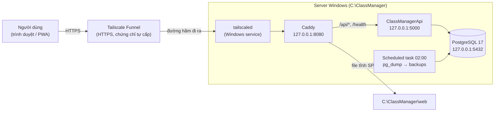

# Triển khai ClassManager trên server Windows tự quản

Tài liệu cho người vận hành: cài mới, cập nhật phiên bản, sao lưu/khôi phục và xử lý sự cố.
Các script nằm ở [deploy/windows/](../deploy/windows/), đều **idempotent** (chạy lại bao nhiêu lần cũng được).

## 1. Kiến trúc



| Thành phần | Chạy dưới dạng | Ghi chú |
|---|---|---|
| Tailscale Funnel | Service `Tailscale` | Đưa `https://<máy>.<tailnet>.ts.net` ra Internet qua kết nối **đi ra**. Không cần mở port, không cần IP tĩnh, chạy được sau CGNAT. Miễn phí |
| Caddy | Service `Caddy` | Phục vụ SPA, proxy `/api/*` và `/health` sang API. Chỉ HTTP trên loopback, TLS do Funnel lo |
| API | Service `ClassManagerApi` | .NET 10 self-contained (không cần cài runtime), chạy bằng virtual account `NT SERVICE\ClassManagerApi`, phụ thuộc Postgres |
| PostgreSQL 17 | Service `postgresql-x64-17` | Chỉ lắng nghe `127.0.0.1` |
| Backup | Scheduled task `ClassManager DB Backup` | 02:00 hằng ngày, chạy bằng SYSTEM, giữ 14 ngày |

Mọi cổng đều chỉ bind loopback. Từ mạng LAN hay Internet chỉ vào được qua Funnel.

### Thư mục trên server

| Đường dẫn | Nội dung |
|---|---|
| `C:\ClassManager\api` | Bản publish API + `appsettings.json` production (**chứa bí mật**, chỉ Administrators/SYSTEM và service account đọc được) |
| `C:\ClassManager\web` | Bản build FE (`dist/`) |
| `C:\ClassManager\caddy` | `caddy.exe` + `Caddyfile` |
| `C:\ClassManager\secrets` | Mật khẩu Postgres, JWT key, `pgpass.conf`. Chỉ Administrators/SYSTEM. **Không bao giờ commit/gửi đi** |
| `C:\ClassManager\backups` | File dump `classmanager_yyyyMMdd_HHmm.dump` |
| `C:\ClassManager\scripts` | Script backup mà scheduled task gọi |
| `C:\ClassManager\logs` | `caddy.log`, `caddy-access.log`, `backup.log` |
| `%LOCALAPPDATA%\ClassManagerBuild` | Thư mục build tạm (staging) |

## 2. Cài mới

### Yêu cầu
- Windows 10/11 Pro hoặc Windows Server, tài khoản có quyền Administrator.
- .NET SDK 10 và Node.js 20+ (chỉ dùng để **build**). Script tự tìm `dotnet` trên PATH hoặc ở `%USERPROFILE%\.dotnet`. `npm` được tìm trên PATH hoặc trong `%USERPROFILE%\tools\node-*`.
- Git checkout của repo.

### Chạy cài đặt
Mở PowerShell **Run as Administrator**:

```powershell
powershell -ExecutionPolicy Bypass -File D:\Class_management\deploy\windows\00-install-all.ps1
```

| Script | Việc làm |
|---|---|
| `01-install-postgres.ps1` | Cài PostgreSQL 17 (bỏ pgAdmin/StackBuilder), khoá `listen_addresses` về `127.0.0.1`, tạo role và DB `classmanager`, sinh mật khẩu vào `secrets\` |
| `02-publish-api.ps1` | `dotnet publish` win-x64 self-contained, copy vào `api\`, tạo service. Lần đầu sinh `appsettings.json` production (connection string local, `Jwt:Key` ngẫu nhiên), sau đó chờ `/health` |
| `03-publish-web.ps1` | `npm ci` + `npm run build` (có `tsc`), copy `dist\` vào `web\` |
| `04-install-caddy.ps1` | Tải Caddy, cài service, chép [Caddyfile](../deploy/windows/Caddyfile) |
| `05-backup-task.ps1` | Đăng ký backup 02:00 và chạy thử một lần |
| `06-power.ps1` | Khi cắm sạc: không sleep/hibernate, gập nắp không làm gì (cho laptop làm server) |
| `07-windows-update.ps1` | Active hours 7h–22h để Windows Update không tự khởi động lại trong giờ làm việc |
| `99-verify.ps1` | Kiểm tra: service, health, SPA, login sai trả 401, port chỉ loopback, bảng DB, backup |

> **Postgres tải lỗi 403 giữa chừng?** CDN của EDB hay cắt file lớn. Hãy tải trước bằng curl (có resume) rồi chạy lại script, script sẽ tự kiểm tra SHA-256 và dùng file này:
> ```powershell
> $d = "$env:LOCALAPPDATA\ClassManagerBuild\installers"; mkdir $d -Force
> curl.exe -L --retry 5 -C - -o "$d\postgresql-17.11-5-windows-x64.exe" https://get.enterprisedb.com/postgresql/postgresql-17.11-5-windows-x64.exe
> ```

### Tài khoản owner
Ở Production, API **không** tự tạo tài khoản mặc định. Có 2 cách để có tài khoản:
- Khôi phục DB có sẵn người dùng (mục 5).
- Thêm tạm `"Owner": { "Email": "...", "Password": "..." }` vào `C:\ClassManager\api\appsettings.json`, rồi `Restart-Service ClassManagerApi`. Đăng nhập xong thì **xoá khối này** và đổi mật khẩu.

### Đưa ra Internet bằng Tailscale Funnel
1. Cài Tailscale (`winget install Tailscale.Tailscale`), rồi đăng nhập.
2. Trong admin console (https://login.tailscale.com/admin):
   - **DNS** → đặt tên tailnet và bật **MagicDNS** + **HTTPS Certificates**.
   - **Machines** → đổi tên máy (ví dụ `classmanager`) → menu `…` → **Disable key expiry**. Nếu không tắt, khoá máy hết hạn sau 180 ngày và Funnel ngừng chạy.
3. PowerShell Administrator:
   ```powershell
   tailscale up --unattended                    # chạy cả khi chưa có ai đăng nhập Windows
   tailscale funnel --bg http://127.0.0.1:8080  # lần đầu sẽ in link để bật Funnel cho tailnet
   tailscale funnel status
   ```
4. Kiểm tra từ một máy **không** cài Tailscale (ví dụ điện thoại dùng 4G): `https://<máy>.<tailnet>.ts.net/health` phải trả `ok`. DNS công khai có thể mất vài phút mới cập nhật.

> Trên chính server, tên `*.ts.net` được MagicDNS phân giải thành IP 100.x (đi trong tailnet), nên test tại server **không** chứng minh truy cập từ ngoài. Muốn xem DNS công khai: `Invoke-RestMethod 'https://dns.google/resolve?name=<máy>.<tailnet>.ts.net&type=A'`.

Hiện tại: `https://classmanager.ayu-dorian.ts.net`.

## 3. Cập nhật phiên bản

```powershell
cd D:\Class_management; git pull
# PowerShell Administrator:
powershell -ExecutionPolicy Bypass -File .\deploy\windows\02-publish-api.ps1   # nếu backend đổi
powershell -ExecutionPolicy Bypass -File .\deploy\windows\03-publish-web.ps1   # nếu frontend đổi
powershell -ExecutionPolicy Bypass -File .\deploy\windows\99-verify.ps1
```

- `02` dừng API, copy bản mới (giữ nguyên `appsettings.json`) rồi khởi động lại. Thời gian gián đoạn vài giây. Migration và schema patch tự chạy lúc khởi động.
- `03` chỉ thay file tĩnh, không cần restart. Người dùng PWA nhận bản mới ở lần mở app kế tiếp (`registerType: autoUpdate`).
- Cần sửa gấp khi `tsc` đang lỗi: `03-publish-web.ps1 -SkipTypeCheck`.
- Có thể build trước mà không cần quyền admin: thêm `-BuildOnly`.
- Muốn **quay lại bản cũ**: `git checkout <commit>` rồi chạy lại `02`/`03`. Nên chạy `backup-classmanager.ps1` trước khi deploy bản có thay đổi schema.

## 4. Sao lưu

- Tự động lúc 02:00, giữ 14 ngày. Kết quả ghi ở `C:\ClassManager\logs\backup.log`.
- Chạy tay: `Start-ScheduledTask 'ClassManager DB Backup'`.
- **Chưa có bản sao ngoài máy.** Ổ cứng hỏng hoặc mất máy thì mất luôn backup. Nên định kỳ chép `C:\ClassManager\backups` ra ổ ngoài hoặc cloud.

## 5. Khôi phục

PowerShell Administrator, thay `<file>` bằng file dump cần khôi phục:

```powershell
$bin = 'C:\Program Files\PostgreSQL\17\bin'
Stop-Service ClassManagerApi
$env:PGPASSFILE = 'C:\ClassManager\secrets\pgpass.conf'
& "$bin\pg_restore.exe" -h 127.0.0.1 -U classmanager -d classmanager --clean --if-exists --no-owner --no-acl <file>.dump
Remove-Item Env:PGPASSFILE
Start-Service ClassManagerApi
```

Muốn khôi phục vào **DB sạch** (ví dụ chuyển từ server khác), hãy dùng user `postgres` (mật khẩu ở `secrets\postgres-superuser.txt`) để `DROP DATABASE classmanager WITH (FORCE)` rồi `CREATE DATABASE classmanager OWNER classmanager ENCODING 'UTF8' TEMPLATE template0`, sau đó `pg_restore` như trên.

### Chuyển dữ liệu từ PostgreSQL khác (đã làm khi rời Supabase, 11/2026)
1. Dump schema `public` từ nguồn:
   ```powershell
   $env:PGSSLMODE='require'
   pg_dump -h <host> -U <user> -d <db> -n public --no-owner --no-acl -Fc -f source.dump
   ```
   Mật khẩu nhập qua `$env:PGPASSWORD`, không ghi vào file.
2. Kiểm tra nội dung bằng `pg_restore -l source.dump`. Chỉ được có các bảng của app và `__EFMigrationsHistory`.
3. Tạo DB sạch như trên, rồi `pg_restore --exit-on-error`. Loại các dòng `SCHEMA - public` và `COMMENT - SCHEMA public` qua `-L` vì schema đã có sẵn.
4. So số dòng từng bảng giữa nguồn và đích, rồi `Start-Service ClassManagerApi`.
5. Mật khẩu đã băm được chép nguyên, nên người dùng đăng nhập bằng mật khẩu cũ. JWT cũ không còn dùng được (khác `Jwt:Key`), mọi người chỉ cần đăng nhập lại.

## 6. Vận hành hằng ngày

| Việc | Lệnh |
|---|---|
| Trạng thái | `Get-Service postgresql-x64-17, ClassManagerApi, Caddy, Tailscale` |
| Kiểm tra tổng | `deploy\windows\99-verify.ps1` (Administrator) |
| Restart API | `Restart-Service ClassManagerApi` |
| Log API | Event Viewer → Windows Logs → Application, source `ClassManager.API` |
| Log Caddy | `C:\ClassManager\logs\caddy*.log` |
| Funnel | `tailscale funnel status` |

Các service đều ở chế độ Automatic, tự chạy lại khi lỗi và tự khởi động khi bật máy mà **không cần ai đăng nhập Windows**.

## 7. Xử lý sự cố

| Hiện tượng | Kiểm tra |
|---|---|
| Ngoài Internet không vào được | `tailscale status` (máy có online?), `tailscale funnel status`. Admin console: máy có bị hết hạn khoá không? |
| Trang trắng / 502 | `Invoke-WebRequest http://127.0.0.1:5000/health`. Nếu lỗi, xem Event Viewer (source `ClassManager.API`) |
| API không khởi động sau khi cập nhật | Thường do migration hoặc schema patch. Xem Event Viewer; chạy thử `C:\ClassManager\api\ClassManager.API.exe` trong cửa sổ Administrator để đọc lỗi trực tiếp |
| `Connection refused` tới Postgres | `Get-Service postgresql-x64-17`; log ở `C:\Program Files\PostgreSQL\17\data\log` |
| Người dùng vẫn thấy bản cũ | Đóng hẳn app hoặc tab rồi mở lại (service worker cập nhật ở lần tải kế tiếp) |
| Backup không có file mới | `C:\ClassManager\logs\backup.log`, `Get-ScheduledTaskInfo 'ClassManager DB Backup'` |

## 8. Giới hạn và lưu ý

- **Server là laptop**: mất điện, mất mạng hoặc tắt máy thì app ngừng. Phải luôn cắm sạc; Windows Update vẫn có thể restart ngoài giờ 7h–22h (các service tự lên lại).
- **Chỉ một instance API**: cache trạng thái tài khoản (`UserStatusCache`) nằm trong bộ nhớ.
- **Funnel** chỉ nhận cổng 443/8443/10000 và có giới hạn băng thông, đủ cho vài chục người dùng nội bộ. Tên miền là `*.ts.net`; nếu sau này có domain riêng thì thay Funnel bằng Cloudflare Tunnel hoặc mở port, Caddy cấu hình gần như giữ nguyên.
- `Dockerfile`, `vercel.json` và `.npmrc` là di sản từ lần deploy Vercel/Render, không dùng trong mô hình này.
